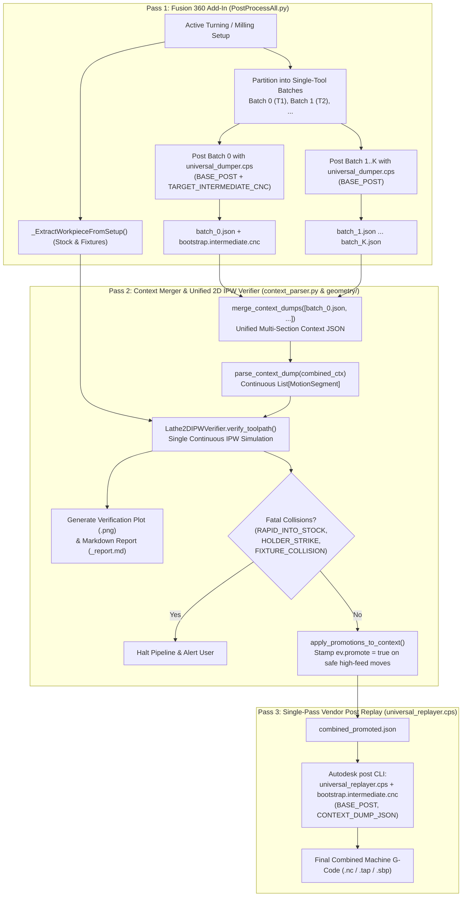

# Context-Dump, Unified Verification & Single-Pass Replay Architecture

> This document defines the authoritative architecture and tool interfaces for the **Fusion 360 Batch Post & Lathe IPW Verification Pipeline**, superseding earlier per-batch wrapper and G-code text stitching prototypes.

---

## 1. Architectural Motivation & Core Principles

### 1.1 Why Context-Dump + Single-Pass Replay?
Fusion 360 Personal Edition enforces two fundamental restrictions on turning and multi-tool setups:
1. **Multi-Tool Post Restriction**: Fusion Personal Edition blocks `NCProgram.postProcess()` when operations in a single `NCProgram` use multiple distinct tool numbers (`T1`, `T2`, etc.).
2. **High-Feed Linear Substitution**: Fusion Personal Edition replaces rapid traverse moves (`G0` / `MOVEMENT_RAPID`) with high-feed linear moves (`G1` / `MOVEMENT_HIGH_FEED`) inside the CAM kernel before invoking any `.cps` post processor.

Earlier iterations attempted to work around the multi-tool restriction by posting each single-tool batch into separate G-code files and stitching those G-code files together with regular expressions (`_StitchGcodeFiles`). However, text-level G-code stitching is inherently fragile across diverse CNC dialects (Centroid, Tormach PathPilot, ShopBot OpenSBP, Acu-Rite MillPwr G2, Fanuc, Haas) because each vendor post has its own:
- Header tool table and global Z-range summary (`getToolTable()`, `getGlobalZRange()`),
- Dialect-specific tool change sequences, safety retracts (`G28`, `G53`, `M9`, `M5`), and work-offset resets,
- Cross-section lookahead (`getPreviousSection()`, `getNextSection()`, `getNextTool()`),
- Modal state machines (`gMotionModal`, `gPlaneModal`, `gAbsIncModal`, `gFeedModeModal`, `feedOutput`),
- Sequence numbering (`N10`, `N20`, ...).

By separating **Pass 1: Per-Batch Context Extraction (`universal_dumper.cps`)** from **Pass 2: Unified Verification & Single-Pass Vendor Replay (`universal_replayer.cps`)**, we execute the **unmodified vendor `.cps` script once** across the entire merged multi-tool setup inside the official Autodesk `post` binary.

---

### 1.2 Seven Core Architectural Invariants
1. **Single Pathway (Zero G-Code Parsing)**: Never parse machine G-code (`parse_cnc_file` is permanently removed). All geometric verification operates strictly on exact floating-point coordinates captured from the Fusion Post Kernel via [`universal_dumper.cps`](file:///Users/vadimf/Documents/Fusion360-Batch-Post-master/universal_dumper.cps).
2. **Per-Batch Context Extraction**: Operations in a setup are partitioned into single-tool batches (`[(tool_num, [op1, ...]), ...]`). Each single-tool batch is posted individually through [`universal_dumper.cps`](file:///Users/vadimf/Documents/Fusion360-Batch-Post-master/universal_dumper.cps) (which dynamically loads the target `BASE_POST` so kernel tolerances, `minimumChordLength`, `maximumCircularRadius`, and `allowedCircularPlanes` match the target machine).
3. **Dialect-Independent Multi-Operation Merging**: [`merge_context_dumps()`](file:///Users/vadimf/Documents/Fusion360-Batch-Post-master/context_parser.py#L29-L115) in [`context_parser.py`](file:///Users/vadimf/Documents/Fusion360-Batch-Post-master/context_parser.py) merges the per-batch JSON context dumps into a single unified multi-section context document, re-indexing `id` (`0..N-1`), `batchIdx`, and `batchSectionIdx`.
4. **Unified Continuous IPW Verification**: [`parse_context_dump()`](file:///Users/vadimf/Documents/Fusion360-Batch-Post-master/context_parser.py#L118-L295) extracts a single continuous `List[MotionSegment]` across all tools and operations. [`Lathe2DIPWVerifier.verify_toolpath()`](file:///Users/vadimf/Documents/Fusion360-Batch-Post-master/geometry/lathe_engine.py#L87-L320) is invoked **once** on the complete setup so that in-process workpiece (IPW) stock removal carries over accurately from Tool 1 (e.g., Roughing) to Tool 2 (e.g., Finishing/Grooving/Drilling).
5. **Global Rapid Promotion with Direct Event Stamping**: Rapid promotion decisions (`promoted_vectors`) are computed on the combined setup against the evolving 2D IPW stock (with `c_clear` safety clearance) and stamped directly onto the corresponding merged JSON events (`ev["promote"] = True`) via [`apply_promotions_to_context()`](file:///Users/vadimf/Documents/Fusion360-Batch-Post-master/context_parser.py#L298-L355).
6. **Single-Pass Unmodified Vendor Post Replay**: [`universal_replayer.cps`](file:///Users/vadimf/Documents/Fusion360-Batch-Post-master/universal_replayer.cps) compiles the unmodified vendor `.cps` inside a lexical closure that shadows the C++ engine's read-only globals (`currentSection`, `tool`, `movement`, etc.) and replays the entire multi-tool `onOpen() -> for each section: onSection() / events / onSectionEnd() -> onClose()` lifecycle in a single invocation.
7. **Zero Modification of Stock Vendor Posts**: Stock vendor posts (`centroid_turning.cps`, `tormach.cps`, `shopbot.cps`, `acurite millpwr 2.cps`, etc.) remain 100% untouched.

---

## 2. End-to-End Pipeline Architecture



---

## 3. Component & Tool Interfaces

### 3.1 `universal_dumper.cps` (Context & Intermediate Extractor)
Executed by the Autodesk Fusion Post Kernel (`post` binary or `NCProgram.postProcess()`).

#### Input Environment Variables
| Variable | Required | Description |
| :--- | :---: | :--- |
| `BASE_POST` | Optional (Recommended) | Absolute path to the target vendor `.cps` post processor. When provided, `universal_dumper.cps` evaluates the vendor post inside `buildVendor` so that kernel variables (`tolerance`, `minimumChordLength`, `maximumCircularRadius`, `allowedCircularPlanes`, `mapWorkOrigin`) match the target machine. |
| `TARGET_INTERMEDIATE_CNC` | Optional | Absolute destination path where `universal_dumper.cps` copies the Fusion kernel's binary/Compact-NCI intermediate file (`getIntermediatePath()`) via `copyFile()`. |

#### Output Schema (`batch_i.json`)
```json
{
  "formatVersion": 2,
  "unit": 0,
  "programName": "1001",
  "programComment": "Setup1",
  "hostname": "MacBook-Pro.local",
  "modelPath": "/path/to/model",
  "intermediatePath": "/var/folders/.../occ.cnc",
  "machineConfiguration": { "...": "..." },
  "globalParameters": {
    "product-id": "fusion360",
    "generated-by": "Fusion CAM 2601.1.32",
    "job-description": "Setup1"
  },
  "sections": [
    {
      "id": 0,
      "type": 1,
      "unit": 0,
      "workOffset": 1,
      "workOrigin": [0.0, 0.0, 0.0],
      "workPlane": [[1, 0, 0], [0, 1, 0], [0, 0, 1]],
      "wcsOrigin": [0.0, 0.0, 0.0],
      "wcsPlane": [[1, 0, 0], [0, 1, 0], [0, 0, 1]],
      "initialPosition": [26.0, 0.0, 2.0],
      "finalPosition": [26.0, 0.0, 5.0],
      "globalZRange": [0.0, 5.0],
      "spindle": 0,
      "feedMode": 1,
      "tool": {
        "number": 1,
        "type": 100,
        "compensationOffset": 1,
        "diameterOffset": 1,
        "lengthOffset": 1,
        "diameter": 0.0,
        "cornerRadius": 0.4,
        "fluteLength": 0.0,
        "bodyLength": 25.0,
        "shaftDiameter": 16.0,
        "numberOfFlutes": 1,
        "spindleRPM": 1500,
        "surfaceSpeed": 150.0,
        "maximumSpindleSpeed": 3500,
        "clockwise": true,
        "coolant": 1,
        "hand": "R",
        "holderType": 0,
        "description": "VNMG 331",
        "comment": "Roughing",
        "vendor": "Kennametal",
        "productId": "VNMG331",
        "extent": [[0, 0, 0], [16, 16, 100]]
      },
      "parameters": {
        "operation-comment": "Profile Roughing1",
        "operation-strategy": "turningProfileRoughing",
        "leads-same-feedrate": 1
      },
      "events": [
        { "fn": "onMovement", "args": [0], "mov": 0 },
        { "fn": "onLinear", "args": [25.329, 0.0, 2.54, 2540.0], "mov": 5, "rc": 0 },
        {
          "fn": "onCircular",
          "args": [true, 20.0, 0.0, -5.0, 20.4, 0.0, -5.0, 150.0],
          "mov": 1,
          "rc": 0,
          "normal": [0.0, 1.0, 0.0],
          "radius": 0.4,
          "sweep": 1.570796,
          "fullCircle": false,
          "plane": 1,
          "linearizedMoves": [
            [20.12, 0.0, -4.62, 150.0],
            [20.4, 0.0, -5.0, 150.0]
          ]
        }
      ]
    }
  ]
}
```

---

### 3.2 `context_parser.py` (Context Merger, Normalizer & Promotion Stamper)
Provides four pure Python functions bridging [`universal_dumper.cps`](file:///Users/vadimf/Documents/Fusion360-Batch-Post-master/universal_dumper.cps), [`Lathe2DIPWVerifier`](file:///Users/vadimf/Documents/Fusion360-Batch-Post-master/geometry/lathe_engine.py), and [`universal_replayer.cps`](file:///Users/vadimf/Documents/Fusion360-Batch-Post-master/universal_replayer.cps):

| Function | Signature | Responsibility |
| :--- | :--- | :--- |
| [`load_context_dump`](file:///Users/vadimf/Documents/Fusion360-Batch-Post-master/context_parser.py#L22-L26) | `(json_path: str) -> Dict[str, Any]` | Loads a single JSON context dump produced by `universal_dumper.cps`. |
| [`merge_context_dumps`](file:///Users/vadimf/Documents/Fusion360-Batch-Post-master/context_parser.py#L29-L115) | `(json_paths_or_dicts: Sequence[Union[str, Dict]]) -> Dict[str, Any]` | Concatenates `sections` across all single-tool batches, re-indexes `sec["id"] = 0..N-1`, records `batchIdx` and `batchSectionIdx`, and merges `globalParameters`. |
| [`parse_context_dump`](file:///Users/vadimf/Documents/Fusion360-Batch-Post-master/context_parser.py#L118-L295) | `(ctx_or_path: Union[str, Dict], scale_override: Optional[float] = None) -> List[MotionSegment]` | Converts all `onRapid`, `onLinear`, `onCircular`, and `onCyclePoint` events across all sections into a continuous millimeter-normalized `List[MotionSegment]`. Preserves `section_id`, `event_idx`, `batch_idx`, and `occurrence` in `seg.metadata`. |
| [`apply_promotions_to_context`](file:///Users/vadimf/Documents/Fusion360-Batch-Post-master/context_parser.py#L298-L355) | `(context: Dict[str, Any], segments: Sequence[MotionSegment], promoted_vectors: Dict[str, PromotionRule]) -> int` | Matches verified `promoted_vectors` (respecting `rule.min_occur`) back to their exact `(section_id, event_idx)` in `context` and stamps `ev["promote"] = True`. |

---

### 3.3 `Lathe2DIPWVerifier` (`geometry/lathe_engine.py`)
Executes analytical 2D axisymmetric In-Process Workpiece (IPW) simulation using Shapely polygon boolean operations.

#### Inputs
- `segments: Sequence[MotionSegment]` — Continuous toolpath sequence across all tools in the setup (in mm).
- `tools_by_op: Mapping[str, ToolAssembly]` — Analytical cutter and holder polygons for each operation (`generate_rhombic_insert`, `generate_grooving_insert`, `generate_drill_cutter`, `generate_turning_holder`).
- `workpiece: WorkpieceDefinition` — Initial cylindrical/tubular stock (`AxisymmetricStock2D`) and chuck jaw obstacles (`AxisymmetricChuckObstacle`).

#### Outputs (`VerificationReport`)
- `collisions: List[CollisionEvent]` — Classified into `RAPID_INTO_STOCK`, `HOLDER_STRIKE`, `FIXTURE_COLLISION`, and ` EXCESSIVE_DEPTH_OF_CUT`.
- `promoted_vectors: Dict[str, PromotionRule]` — Dictionary mapping safe high-feed traverse `VectorKey` strings (`"X1_Z1_X2_Z2"`) to `PromotionRule(min_occur=k)`. A high-feed linear move (`is_high_feed=True` or `feed >= high_feed_threshold`) is promoted if and only if its swept cutter+holder envelope maintains at least `c_clear` (default `0.5 mm`) clearance from both the current IPW stock and chuck fixtures on that occurrence and all subsequent occurrences.
- `mrr_spikes: List[MRRSpikeEvent]` & `total_volume_removed_mm3: float` — Material removal volume integrated via Pappus's Centroid Theorem ($V = 2\pi \cdot A \cdot \bar{x}$).

---

### 3.4 `universal_replayer.cps` (Single-Pass Vendor Post Replayer)
Executed by the Autodesk `post` CLI binary using any valid `.cnc` file as a bootstrap carrier (since `post` requires a syntactic `.cnc` positional argument before invoking `onOpen`/`onClose`).

#### Input Environment Variables
| Variable | Required | Description |
| :--- | :---: | :--- |
| `BASE_POST` | **Yes** | Absolute path to the unmodified vendor `.cps` post processor (`centroid_turning.cps`, `tormach.cps`, `shopbot.cps`, `acurite millpwr 2.cps`, etc.). |
| `CONTEXT_DUMP_JSON` | **Yes** | Absolute path to the merged (and optionally promotion-stamped) JSON context dump. |
| `PROMOTED_MOVES_JSON` | Optional | Optional path to a `promoted_moves.json` dictionary (`{ "X1_Z1_X2_Z2": { "minOccur": k } }`) for backwards-compatible vector-key promotion when `ev.promote` is not pre-stamped. |
| `POST_PROPERTIES_JSON` | Optional | Optional JSON object of user post-processor property overrides (`{ "showSequenceNumbers": "false", ... }`) applied via `setProperty(k, v)` before `onOpen()`. |

For complete implementation details and corner-case handling inside [`universal_replayer.cps`](file:///Users/vadimf/Documents/Fusion360-Batch-Post-master/universal_replayer.cps), see [`docs/universal_replayer.md`](file:///Users/vadimf/Documents/Fusion360-Batch-Post-master/docs/universal_replayer.md).
