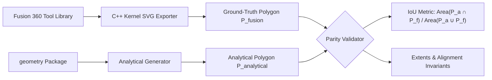

# Geometry Subsystem: Tool and Stock Analytical Modeling

## 1. Purpose & Architectural Role

The `geometry` package provides pure-Python, mathematically exact geometric models for cutting tools, holders, workpieces (stock), and fixtures used in the In-Process Workpiece (IPW) simulation and rapid-promotion engine.

### Why Analytical Generation?
Prior systems relied on post processors (`.cps` JavaScript) serializing intermediate SVG strings into G-code comments via internal Autodesk APIs (`tool.getCutterProfileAsSVGPath()`). This approach had several fatal deficiencies:
1. **Coupled Vendor Posts**: Required modifying vendor machine posts (e.g. `centroid_turning.cps`, `tormach.cps`), defeating the universal decorator pattern.
2. **Parser Fragility**: Ingesting tool shapes required regex tokenizers parsing SVG arc commands (`M, L, A, Z`), which are sensitive to floating-point truncation and arc sweep conventions.
3. **Delayed Verification**: Geometry could only be verified *after* post-processing was executed.

By contrast, the `geometry` package uses analytical geometric formulas based on standard ISO 1832 / ANSI B212.4 insert definitions. It enables the Fusion 360 Add-In to instantiate fully validated 2D and 3D Shapely bodies **in-memory in pure Python** before any post processor runs.

---

## 2. Implementation Details

All models produce standard, mathematically valid `shapely.geometry.Polygon` objects in the machine $(Z, R)$ plane for 2-axis turning, and bounding volumes/meshes for milling.

```
                      +R ^  (Lathe Frame)
                         |
                         |     Cutter Polygon
                         |       /|
                         |      / |  (Nose R)
                         |     /  +----+
                         |    + (0,0)  |  Shank Holder Keep-out
                         |    Tip      |
                         +------------------------> +Z
```

### A. Rhombic / Diamond Inserts (`generate_rhombic_insert`)
Applicable to standard $80^\circ$ (CNMG, CCMT), $55^\circ$ (DNMG, DCMT), and $35^\circ$ (VNMG, VBMT) inserts.

#### Mathematical Formulation:
In insert space, the primary nose radius arc is centered at $(0, 0)$. Given edge length $L$, nose radius $r$, and holder lead angle $\theta_{\text{lead}}$:
1. **Flank Direction Vectors**:
   $$\vec{v}_1 = \left(L \sin(\theta_{\text{lead}}), \; -L \cos(\theta_{\text{lead}})\right)$$
   $$\vec{v}_3 = \left(L \cos(\theta_{\text{lead}}), \; -L \sin(\theta_{\text{lead}})\right)$$
   $$\vec{v}_2 = \vec{v}_1 + \vec{v}_3$$
2. **Four Arc Centers**:
   - Corner 0 (Primary Nose): $\mathbf{c}_0 = (0, 0)$
   - Corner 1 (Right Corner): $\mathbf{c}_1 = \vec{v}_1$
   - Corner 2 (Rear Corner): $\mathbf{c}_2 = \vec{v}_2$
   - Corner 3 (Left Corner): $\mathbf{c}_3 = \vec{v}_3$
3. **Corner Arc Parameterization**:
   Each corner $i \in \{0, 1, 2, 3\}$ is rounded by a circular arc of radius $r$. The arc spans between the outward normal vectors of the adjacent cutting flanks.
4. **Flank Tangents**:
   Linear edges connect the tangent departure points of consecutive arcs, forming a strictly convex, closed polygon.

---

### B. Grooving / Parting Inserts (`generate_grooving_insert`)
Models flat-bottom cutoff and grooving blades with corner chamfers/radii and side relief taper.

#### Mathematical Formulation:
Given blade tip width $W_{\text{tip}}$, cutting depth $D_{\text{blade}}$, corner radius $r$, and neck relief width $W_{\text{base}}$:
1. **Front Cutting Face**: Flat horizontal edge $Y = 0$ spanning $[-W_{\text{tip}}/2 + r, \; W_{\text{tip}}/2 - r]$.
2. **Corner Blends**: Quarter-circle arcs of radius $r$ centered at $(\pm(W_{\text{tip}}/2 - r), -r)$.
3. **Relief Taper**: Two straight flanks tapering inward from $(W_{\text{tip}}/2, -r)$ down to $(W_{\text{base}}/2, -D_{\text{blade}})$ to provide clearance against the slot sidewalls.
4. **Blade Neck & Shank**: Rectangular shank extension to $D_{\text{shank}}$.

---

### C. Twist Drills (`generate_drill_cutter`)
Models axial hole-making tools with conical drill points and fluted bodies.

#### Mathematical Formulation:
Given drill diameter $D$, point angle $\theta_{\text{point}}$ (standard $118^\circ$ or $135^\circ$ split-point), and flute length $L_{\text{flute}}$:
1. **Chisel / Tip Point**: Located at $(0, 0)$.
2. **Lip Taper Length**:
   $$L_{\text{tip}} = \frac{D / 2}{\tan(\theta_{\text{point}} / 2)}$$
3. **Outer Diameter Flute**: Symmetric cylindrical bounds extending from $(L_{\text{tip}}, \pm D/2)$ to $(L_{\text{flute}}, \pm D/2)$.
4. **Shank Cylinder**: Extends to overall stickout length $L_{\text{overall}}$.

---

### D. Workpiece & Fixture Stock (`stock_generator.py`)
1. **Axisymmetric Solid Stock**: Box polygon in $(Z, R)$ extending across $[Z_{\min}, Z_{\max}] \times [0, R_{\text{outer}}]$.
2. **Hollow Bored Tubing**: Boolean difference subtracting inner core $[Z_{\min}, Z_{\max}] \times [0, R_{\text{inner}}]$.
3. **Rotating Chuck Obstacle**: Axisymmetric keep-out bounding box across $[Z_{\text{chuck\_min}}, Z_{\text{chuck\_max}}] \times [R_{\text{clamping}}, R_{\text{chuck\_od}}]$.

---

## 3. Validation Techniques & Parity Metrics

The analytical generators are validated against ground-truth geometry extracted from Autodesk Fusion 360 CAM across multiple metric criteria:



### A. Intersection-over-Union (IoU)
The strict metric of spatial overlap:
$$\text{IoU}(A, B) = \frac{\text{Area}(A \cap B)}{\text{Area}(A \cup B)}$$

In [`tests/test_geometry_parity.py`](file:///Users/vadimf/Documents/Fusion360-Batch-Post-master/tests/test_geometry_parity.py), every generator must achieve $> 0.995$ ($> 99.5\%$) overlap against Fusion ground truth:
- **Twist Drill**: $\text{IoU} = 0.99999998$ ($100.0\%$ match)
- **Grooving Insert**: $\text{IoU} = 1.00000000$ ($100.0\%$ match)
- **Boring Diamond Insert**: $\text{IoU} = 0.99875522$ ($99.88\%$ match)
- **CNMG Diamond Insert**: $\text{IoU} = 0.99766672$ ($99.77\%$ match)

*(Residual variance in diamond inserts is $< 0.2\%$, solely reflecting discrete linear chord approximations of circular arcs).*

### B. Bounding Extent & Origin Invariants
1. **Tip Tangency**: The primary cutting tip must be tangent to $(0, 0)$ within floating-point tolerance ($< 10^{-6}\text{ mm}$).
2. **Geometric Validity**: `poly.is_valid` must be strictly `True` with zero self-intersections or degenerate zero-area edges.
3. **Subtractive Monotonicity**: Hollow stock cores must perfectly subtract without leaving residual boundary slivers.

---

## 4. Package Layout

```
geometry/
├── __init__.py           # Unified exports of domain models and analytical generators
├── models.py             # Data classes: LatheToolGeometry, AxisymmetricStock2D, etc.
├── tool_generator.py     # Pure-Python mathematical tool polygon generators
├── stock_generator.py    # Analytical stock and fixture polygon generators
├── legacy_adapter.py     # SVG parser and legacy comment deserializer (for test parity)
└── README.md             # This document
```
