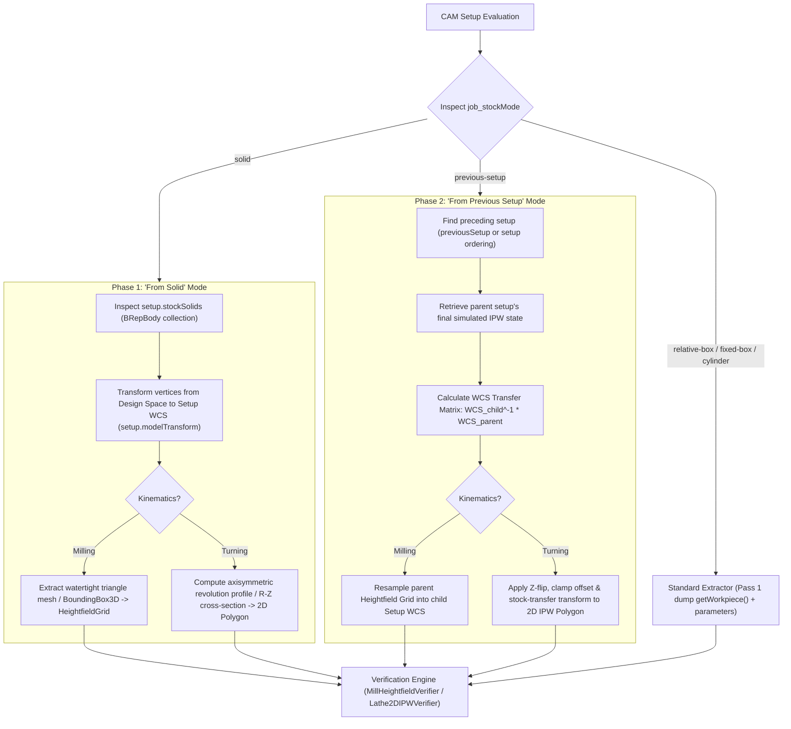

# Architecture & Implementation Plan: "From Solid" & "From Previous Setup" Stock Support

This plan details the architecture and implementation phases for adding native stock extraction, representation, and verification support for setups configured with **"From Solid"** and **"From Previous Setup"** (continuation/rest machining) in Fusion 360 CAM.

---

## 1. Problem Statement & Motivation

Currently, `Fusion360-Batch-Post` supports analytical stock definitions:
- **Milling**: Prismatic bounding boxes (`BoxStock3D`).
- **Turning**: Axisymmetric cylinders and tubes (`AxisymmetricStock2D` with outer radius, inner radius, length, front offset).

When a user selects:
1. **"From Solid"** (`job_stockMode == "solid"`): The stock is defined by one or more B-Rep bodies (`setup.stockSolids`).
2. **"From Previous Setup"** (`job_stockMode == "previous-setup"` / `"from-preceding"`): The stock is dynamically inherited from the remaining in-process workpiece (IPW) of the preceding setup.

Until native mesh-slicing and inter-setup IPW handoff are implemented, these setups must be explicitly detected and rejected with a clear error to prevent verifying against inaccurate bounding-box approximations. Once rejected cleanly, native support will be added in two phases.

---

## 2. Technical Architecture

---

## 3. Phase 1: "From Solid" Stock Extraction

### 3.1 Milling (`MillHeightfieldVerifier` / 3D Heightfield)
1. **BRep Mesh Extraction**:
   - Access `setup.stockSolids` (`adsk.core.ObjectCollection` of `adsk.fusion.BRepBody`).
   - Query triangular meshes via `body.meshManager.createMeshCalculator()` with target tolerance (0.1 mm).
2. **WCS Coordinate Alignment**:
   - Transform mesh coordinates into Setup local coordinate system using `setup.modelTransform.invert()`.
3. **Rasterization into `HeightfieldGrid`**:
   - Rasterize the transformed triangular mesh directly into `HeightfieldGrid`, initializing $(x_i, y_j) \mapsto (z_{\text{top}}, z_{\text{bottom}})$.
   - Supports pre-machined castings, forgings, and irregular stock geometry with full gouge and collision detection.

### 3.2 Turning (`Lathe2DIPWVerifier` / 2D Axisymmetric IPW)
1. **Rotational Envelope Computation**:
   - For solid bodies in turning, compute the axisymmetric envelope around the spindle $Z$-axis:
     $$R = \sqrt{x^2 + y^2}, \quad Z = z$$
2. **2D Profile Construction**:
   - Project transformed surface vertices into the $(Z, R)$ half-plane ($R \ge 0$).
   - Compute the union 2D polygon using Shapely (`unary_union`).
   - Validate spindle alignment (verify solid intersects origin and has axisymmetric symmetry).
   - Initialize `Lathe2DIPWVerifier` with the exact 2D solid profile.

---

## 4. Phase 2: "From Previous Setup" Stock Propagation

### 4.1 Dependency Resolution & Session IPW Registry
1. **Preceding Setup Identification**:
   - Check `setup.parameters.itemByName("job_previousSetup")` or `setup.previousSetup`.
   - Fall back to topological execution order in the active CAM program/document.
2. **Session IPW Registry**:
   - Maintain a session-level registry in memory: `Dict[str, Any]` mapping `setup.name` to the final verified IPW:
     - Turning: `verifier.ipw` (Shapely `Polygon`).
     - Milling: `verifier.grid` (`HeightfieldGrid`).

### 4.2 Part Repositioning & Coordinate Transformation
1. **Transfer Matrix**:
   - Moving a part from Setup 1 (e.g. Op 1) to Setup 2 (e.g. Op 2 flip) involves a coordinate transformation:
     $$T_{\text{transfer}} = M_{\text{setup2}}^{-1} \cdot M_{\text{setup1}}$$
2. **Turning Stock Transfer**:
   - In turning setups, Op 2 typically flips the part along the spindle axis ($Z \to -Z + \Delta Z$).
   - Apply the rigid $(Z, R)$ transformation matrix to the Op 1 surviving stock polygon.
   - Subtract chuck clamping obstacles from Setup 1 and add new chuck obstacles for Setup 2.
3. **Milling Stock Transfer**:
   - Transform and resample the Op 1 3D heightfield grid into the Op 2 WCS coordinate frame.

---

## 5. Phase 3: Integration, Error Handling & Tests

1. **Validation Checks**:
   - Return descriptive user-facing errors if solid body is missing or unmeshed.
   - Return clear dependency error if Setup 2 is processed before Setup 1 has completed successfully.
2. **Unit & Integration Tests**:
   - Hermetic test cases for multi-setup turning flip and 3D solid mesh heightfield rasterization.
