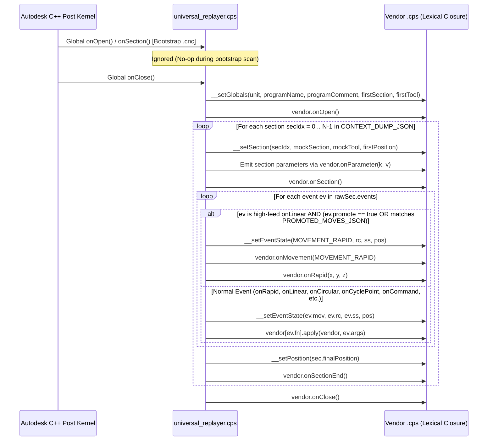

# `universal_replayer.cps` & `universal_dumper.cps` — Internal Design & Corner Cases

> [!NOTE]
> This document details the internal architecture, lexical closure shadowing mechanism, and 10+ post-processor corner cases solved by [`universal_dumper.cps`](file:///Users/vadimf/Documents/Fusion360-Batch-Post-master/universal_dumper.cps) and [`universal_replayer.cps`](file:///Users/vadimf/Documents/Fusion360-Batch-Post-master/universal_replayer.cps), verified for **100% bit-for-bit output parity** across **Centroid Turning (`centroid_turning.cps`)**, **Tormach PathPilot (`tormach.cps`)**, **ShopBot OpenSBP (`shopbot.cps`)**, and **Acu-Rite MillPwr G2 (`acurite millpwr 2.cps`)**.

---

## 1. The Core Challenge: Read-Only C++ Host Globals in SpiderMonkey

Autodesk's `post` kernel embeds a Mozilla SpiderMonkey JavaScript runtime where key per-section and per-record state variables are registered as `JSPROP_READONLY | JSPROP_PERMANENT` native C++ getters on the global object:
- `currentSection` (`Section` C++ object)
- `tool` (`Tool` C++ object)
- `movement` (integer enum: `MOVEMENT_RAPID`, `MOVEMENT_LEAD_IN`, `MOVEMENT_CUTTING`, `MOVEMENT_HIGH_FEED`, etc.)
- `radiusCompensation` (`RADIUS_COMPENSATION_OFF`, `RADIUS_COMPENSATION_LEFT`, `RADIUS_COMPENSATION_RIGHT`)
- `spindleSpeed` (number)
- `highFeedrate` (number)
- `cycle` (object during canned cycles)
- `cycleType` (string during canned cycles, e.g., `"drilling"`, `"chip-breaking"`)
- `cycleExpanded` (boolean)
- `unit` (`IN = 0` or `MM = 1`)
- `programName` (string)
- `programComment` (string)

If a script attempts `currentSection = mockSection` or `tool = mockTool` at global scope, SpiderMonkey silently ignores the assignment (or throws in strict mode), leaving `currentSection` bound to whatever single-tool section exists in the bootstrap `.cnc` file.

---

## 2. Solution: Lexical Closure Shadowing via `new Function(...)`

[`universal_replayer.cps`](file:///Users/vadimf/Documents/Fusion360-Batch-Post-master/universal_replayer.cps) solves this by reading the stock vendor `.cps` source code via `loadText(basePostPath, "utf-8")`, recursively expanding any `include("...")` directives (such as `commonFunctions.cpi` in `tormach.cps` and `acurite millpwr 2.cps`), and compiling the vendor code inside a dynamically constructed factory function (`buildVendor`):

```javascript
var buildVendor = new Function(
  "__ctx",
  "var currentSection, tool, movement, radiusCompensation, spindleSpeed, highFeedrate, " +
  "cycle, cycleType, cycleExpanded, unit, programName, programComment, " +
  "mapWorkOrigin, minimumChordLength, minimumCircularRadius, maximumCircularRadius, " +
  "minimumCircularSweep, maximumCircularSweep, allowHelicalMoves, allowedCircularPlanes, allowSpiralMoves;\n" +
  vendorSrc + "\n" +
  "// Expose modal objects onto `this` for forceModals() in commonFunctions.cpi\n" +
  "if (typeof gMotionModal !== 'undefined') this.gMotionModal = gMotionModal;\n" +
  "... \n" +
  "// Closure-local overrides for C++ host APIs\n" +
  "function getNumberOfSections() { return __ctx.sections.length; }\n" +
  "function getSection(id) { return __ctx.sections[id]; }\n" +
  "... \n"
);
```

Because `var currentSection, tool, movement, ...` are declared inside `buildVendor`'s lexical function scope, **every reference to `currentSection`, `tool`, `movement`, `cycleType`, etc. inside the vendor `.cps` script (and its included `.cpi` files) binds to our mutable closure variables instead of the read-only C++ global object!**

 Meanwhile, all standard C++ kernel classes and formatting primitives (`Vector`, `Matrix`, `Range`, `BoundingBox`, `SpatialPoint`, `createFormat`, `createOutputVariable`, `createModal`, `createIncrementalVariable`, `writeBlock`, `writeln`, `localize`, etc.) remain resolved through the outer global scope with native C++ speed and formatting precision.

---

## 3. Lifecycle Interception & Single-Pass Replay Sequence

When the Autodesk `post` binary runs [`universal_replayer.cps`](file:///Users/vadimf/Documents/Fusion360-Batch-Post-master/universal_replayer.cps) against any bootstrap `.cnc` file:
1. **Top-Level Initialization**:
   - Reads `BASE_POST` and `CONTEXT_DUMP_JSON`.
   - Instantiates the vendor closure inside `ensureInitialized()` and copies top-level vendor configurations (`extension`, `setCodePage`, `capabilities`, `tolerance`, `minimumChordLength`, `maximumCircularRadius`, `allowedCircularPlanes`) out to the global scope.
2. **Suppression of Bootstrap `.cnc` Callbacks**:
   - The top-level `onOpen()`, `onSection()`, `onRapid()`, `onLinear()`, `onCircular()`, `onCyclePoint()`, `onCommand()`, `onComment()`, `onParameter()`, and `onSectionEnd()` callbacks registered on the global object are **no-ops** while the C++ kernel steps through the bootstrap `.cnc` carrier.
3. **Full Multi-Section Replay inside `onClose()`**:
   - Once the C++ kernel finishes scanning the bootstrap `.cnc` and invokes global `onClose()`, [`universal_replayer.cps`](file:///Users/vadimf/Documents/Fusion360-Batch-Post-master/universal_replayer.cps) executes the entire merged context dump in a single pass:



---

## 4. Deep-Dive: 10 Corner Cases & How They Are Solved

### Corner Case 1: Arc Straightening (`linearize()`) — Pre-Callback vs. Runtime Invocation
Arc straightening happens at two distinct layers in Fusion 360:
1. **Kernel-Level Pre-Callback Linearization**:
   - Before invoking `onCircular()`, the C++ kernel checks `minimumChordLength`, `minimumCircularRadius`, `maximumCircularRadius`, `minimumCircularSweep`, `maximumCircularSweep`, `allowHelicalMoves`, `allowSpiralMoves`, and `allowedCircularPlanes`. If an arc violates any of these constraints, the kernel linearizes the arc *before* calling the post script and invokes `onLinear()` directly.
   - **Solution in `universal_dumper.cps`**: By loading `BASE_POST` during Pass 1 and copying the vendor post's exact circular settings to the global scope, the kernel performs identical pre-callback linearization during Pass 1 and records the resulting `onLinear` events directly into `batch_i.json`.
2. **Runtime `linearize(tolerance)` Inside `onCircular()`**:
   - Even when `onCircular()` is called, vendor posts frequently call `linearize(tolerance)` dynamically inside `onCircular()` (e.g., when `isFullCircle()`, when `getCircularRadius() < minimumCircularRadius`, when `useRadius` is enabled and sweep $> 180^\circ$, or in non-standard planes).
   - Inside `onClose()` during replay, the C++ kernel has no active circular record, so calling native `linearize(tolerance)` would throw `Error: Invalid record.`.
   - **Solution in `universal_dumper.cps` & `universal_replayer.cps`**:
     - During Pass 1 (`universal_dumper.cps`), inside `onCircular()`, the dumper temporarily intercepts `onLinear`, invokes the C++ kernel's real `linearize(tolerance)` while the circular record is active, and stores the exact sequence of `[x, y, z, feed]` moves in `ev.linearizedMoves`.
     - During Pass 3 (`universal_replayer.cps`), the closure's `linearize(tol)` function replays `ev.linearizedMoves` into `vendor.onLinear(x, y, z, f)` (or falls back to analytic 3D Rodrigues rotation interpolation around `ev.normal` from `currentPos` to `(x, y, z)` if `linearizedMoves` is absent).

---

### Corner Case 2: Three Flavors of Canned Cycle Expansion (`onCyclePoint`, `expandCyclePoint`, `repositionToCycleClearance`)
Testing across all four vendor posts revealed three distinct patterns for handling drilling/tapping/boring cycles:

| Pattern | Example Vendor Posts | Behavior in Vendor `.cps` | How `universal_dumper.cps` & `universal_replayer.cps` Handle It |
| :--- | :--- | :--- | :--- |
| **Flavor A: Native Canned Cycle (`G81`/`G83`)** | `centroid_turning.cps`, `tormach.cps` (standard drilling), `acurite millpwr 2.cps` (when defined) | Implements `onCycle()`, `onCyclePoint(x, y, z)`, and `onCycleEnd()` to emit modal `G81`/`G83` blocks. | `universal_dumper.cps` captures the entire `cycle` parameter object (`clearance`, `retract`, `stock`, `bottom`, `depth`, `feedrate`, `incrementalDepth`, `dwell`, etc.) and `cycleType` string on `onCycle`, and restores `cycle` & `cycleType` before calling `vendor.onCycle()`, `vendor.onCyclePoint(x, y, z)`, and `vendor.onCycleEnd()`. |
| **Flavor B: `repositionToCycleClearance()` + `expandCyclePoint(x, y, z)`** | `tormach.cps` (e.g., `" bore-milling"`, `"thread-turning"`, or when `expandCyclePoint` is called after `repositionToCycleClearance`) | Calls `repositionToCycleClearance()` first, and then calls `expandCyclePoint(x, y, z)` inside `onCyclePoint()`. | In Fusion's C++ kernel, calling `repositionToCycleClearance()` mutates internal cycle state so a subsequent `expandCyclePoint()` only emits the remaining moves (`afterReposMoves`), whereas calling `expandCyclePoint()` *without* `repositionToCycleClearance()` emits the full sequence (`expandedMoves`). `universal_dumper.cps` captures `reposMoves`, `afterReposMoves`, and `expandedMoves` separately! `universal_replayer.cps` tracks a per-event boolean `__didRepos`: if the vendor post called `repositionToCycleClearance()`, `expandCyclePoint()` replays `afterReposMoves`; otherwise it replays `expandedMoves`. |
| **Flavor C: Omitted `onCyclePoint` Function** | `shopbot.cps`, `acurite millpwr 2.cps` | The vendor `.cps` defines `onCycle()` and `onCycleEnd()`, **but does not define `onCyclePoint` at all**, relying on the C++ kernel to automatically expand every cycle point into `onRapid`/`onLinear` calls! | In `universal_replayer.cps`, when `typeof vendor.onCyclePoint !== "function"`, the replayer automatically invokes `expandCyclePoint(x, y, z)` for each `onCyclePoint` event, replaying `ev.expandedMoves` into `vendor.onRapid` and `vendor.onLinear`. |

---

### Corner Case 3: `getNextRecord().isMotion()` Lookahead (`centroid_turning.cps`)
In [`centroid_turning.cps`](file:///Users/vadimf/Documents/Fusion360-Batch-Post-master/centroid_turning.cps#L1184), inside `onLinear(x, y, z, feed)`:
```javascript
if (xOutput.isSignificant(x) || yOutput.isSignificant(y) || zOutput.isSignificant(z)) {
  writeBlock(gMotionModal.format(isSpeedFeedSynchronizationActive() ? 32 : 1), xOutput.format(x), yOutput.format(y), zOutput.format(z), f);
} else if (f) {
  if (getNextRecord().isMotion()) { // <-- Calls C++ getNextRecord()!
    feedOutput.reset(); // force feed on next block
  } else {
    writeBlock(gMotionModal.format(1), f);
  }
}
```
When an `onLinear` micro-segment has `(x, y, z)` that round to the exact same formatted digits as the previous block and only `feed` changed, `centroid_turning.cps` queries `getNextRecord().isMotion()`. During replay inside `onClose()`, the C++ kernel is positioned at `EOF` of the bootstrap `.cnc`, so native `getNextRecord()` throws `Error: Invalid record.`.
- **Solution**: `universal_replayer.cps` overrides `getNextRecord()` inside the closure to inspect the next event in `rawSec.events[__currentEventIdx + 1]` and return an object implementing `.isMotion()`, `.isLinear()`, `.isRapid()`, `.isCircular()`, `.isCycle()`, and `.getType()`.

---

### Corner Case 4: `getProperty(name, defaultValue)` and `setProperty(name, value)`
Modern Fusion 360 posts (`tormach.cps`, `shopbot.cps`, `acurite millpwr 2.cps`) define `properties = { ... }` inside the `.cps` file and access property values via `getProperty("rotaryTableAxis")` or `getProperty("safePositionMethod")`.
Because `properties` is declared inside `buildVendor`'s closure scope rather than on the C++ global object, the native C++ `getProperty()` function returns `undefined`, causing immediate validation errors (`Error: Valid rotaryTableAxis values are: None, X, Y, Z...` or `Error: Unsupported safe position method 'undefined'`).
- **Solution**: `universal_replayer.cps` defines closure-local `getProperty(name, defaultValue)` and `setProperty(name, val)` functions that inspect `properties[name].value` inside the closure first, falling back to `__hostGetProperty` only if not found.

---

### Corner Case 5: `forceModals()` Reflection on `this` (`commonFunctions.cpi`)
Posts that include `commonFunctions.cpi` (`tormach.cps`, `acurite millpwr 2.cps`) call `forceModals()` or `forceModals(gPlaneModal, gAbsIncModal)` at tool changes:
```javascript
function forceModals() {
  if (arguments.length == 0) {
    var modals = [
      "gMotionModal",
      "gPlaneModal",
      "gAbsIncModal",
      "gFeedModeModal",
      "feedOutput",
      "fourthAxisClamp",
      "fifthAxisClamp",
      "sixthAxisClamp"
    ];
    for (var i = 0; i < modals.length; ++i) {
      if (typeof this[modals[i]] != "undefined") {
        this[modals[i]].reset();
      }
    }
  } ...
}
```
Notice `this[modals[i]].reset()`. In native execution, `this` is the global object where `var gPlaneModal` is a property of `this`. Inside `buildVendor`, `var gPlaneModal` is a local variable of the function activation record, **not** a property of `this` (`vendor`)! Without exposing those modal objects onto `this`, `forceModals()` silently did nothing and `G17 G90` was omitted after tool changes.
- **Solution**: At the end of `buildVendor`, `universal_replayer.cps` explicitly binds `this.gMotionModal = gMotionModal`, `this.gPlaneModal = gPlaneModal`, `this.gAbsIncModal = gAbsIncModal`, `this.gFeedModeModal = gFeedModeModal`, `this.feedOutput = feedOutput`, and the axis clamp modals onto `this`.

---

### Corner Case 6: Multi-Tool Header Tool Table (`getToolTable()`) & Global Z-Range (`getGlobalZRange()`)
In `onOpen()`, milling and router posts (`tormach.cps`, `shopbot.cps`) iterate over `getToolTable()` to print the header tool list (`(T15 D=0.25 ...)`), and for each tool iterate over all sections to compute the minimum Z depth per tool (`zRanges[tool.number].expandToRange(section.getGlobalZRange())`).
- **Solution**:
  - `universal_replayer.cps` deduplicates tools across all merged sections by `tool.number` in order of appearance and provides a closure-local `getToolTable()` returning `{ getNumberOfTools(), getTool(i) }`.
  - Each `Section` mock returns a real C++ `Range(zMin, zMax)` from `getGlobalZRange()`, augmented with `.expandToRange(other)` and `.expandTo(v)` helper methods if not natively present on the C++ `Range` prototype.

---

### Corner Case 7: Cross-Section Lookahead & Tool Preloading (`getPreviousSection()`, `getNextSection()`, `getNextTool()`)
In multi-tool setups:
- Every vendor post determines whether to emit a tool change (`M6 T...`), retract to home (`G28`/`G53`), or reset work offsets by checking `isFirstSection()`, `isLastSection()`, `hasPreviousSection()`, `hasNextSection()`, `getPreviousSection()`, and `getNextSection()`.
- Posts supporting ATC tool preloading (`acurite millpwr 2.cps`, `tormach.cps`) call `getNextTool(tool.number)` to stage the next tool in the carousel immediately after changing tools.
- **Solution**: `universal_replayer.cps` implements all section navigation functions (`getNumberOfSections()`, `getSection(i)`, `getCurrentSectionId()`, `isFirstSection()`, `isLastSection()`, `hasPreviousSection()`, `hasNextSection()`, `getPreviousSection()`, `getNextSection()`, `getNextTool(currentToolNumber)`) directly over the merged `__ctx.sections` array.

---

### Corner Case 8: Rapid Promotion (`G1` High-Feed $\rightarrow$ Native `G0` / `J3`) & Modal Restoration
When a high-feed `onLinear(x, y, z, feed)` event is marked for promotion (`ev.promote === true` or matched in `PROMOTED_MOVES_JSON`):
1. `universal_replayer.cps` transitions `movement` to `MOVEMENT_RAPID` (calling `vendor.onMovement(MOVEMENT_RAPID)` if defined).
2. Calls `vendor.onRapid(x, y, z)` instead of `vendor.onLinear(x, y, z, feed)`.
3. Because we call the vendor post's own `onRapid(x, y, z)` method:
   - Standard G-code posts (`centroid_turning.cps`, `tormach.cps`, `acurite millpwr 2.cps`) format `gMotionModal.format(0)` (`G0`) and reset their internal motion modal state.
   - Non-G-code posts like ShopBot OpenSBP (`shopbot.cps`) execute their native rapid handler (`writeBlock("J3", x, y, z)`) and set `sbpModal.motion = "J3"`.
4. On the subsequent cutting `onLinear` event, the vendor post's own modal tracker (`gMotionModal` or `sbpModal.motion`) sees that the current modal state is rapid (`G0` or `J3`) and automatically emits `G1 X... Z... F...` (or `M3, x, y, z` with speed restoration in OpenSBP). Furthermore, `universal_replayer.cps` explicitly calls `this.feedOutput.reset()` after a promoted rapid move so posts that separate `gMotionModal` from `feedOutput` always re-emit the cutting `F` word on the first cutting block after a rapid traverse.

---

### Corner Case 9: Zero-Length Initial Moves in `context_parser.py`
In Fusion 360, the first motion event in a section frequently targets the exact `initialPosition` (`dist == 0.0`). If zero-length segments are emitted into `MotionSegment`, they shift per-vector occurrence counters and create degenerate zero-length sweeps.
- **Solution**: `parse_context_dump()` in [`context_parser.py`](file:///Users/vadimf/Documents/Fusion360-Batch-Post-master/context_parser.py) filters out `onRapid`/`onLinear` moves with Euclidean length $< 10^{-9}\text{ mm}$, matching the exact segment indexing of `apt.cps`.

---

### Corner Case 10: Tool `getExtent(boolean)` and 3-Axis vs. 5-Axis Section Methods in `universal_dumper.cps`
During Pass 1 (`universal_dumper.cps`):
- Calling `tool.getExtent()` without arguments throws `Error: Mismatching number of arguments for invocation of 'unsupported Tool.getExtent(boolean) const'`. Passing `tool.getExtent(false)` succeeds on all tool types.
- Calling `currentSection.getInitialToolAxisABC()` on a 2-axis turning or 3-axis milling section throws `Error: Section.getInitialToolAxisABC() is not allowed for section.`. Guarding `getInitialToolAxisABC()` behind `currentSection.isMultiAxis()` prevents this exception.

---

## 5. Empirical Verification Matrix

All four vendor posts are tested in [`tests/test_universal_replayer_four_posts.py`](file:///Users/vadimf/Documents/Fusion360-Batch-Post-master/tests/test_universal_replayer_four_posts.py):

| Vendor Post | Dialect | Single-Tool Passthrough (`diff -u`) | 2-Tool Merged Setup (Header, Tool Change, Preload, Footer) | Rapid Promotion (`G0` / `J3`) + Feed Restoration | Arcs & Canned/Expanded Cycles |
| :--- | :--- | :---: | :---: | :---: | :---: |
| **`centroid_turning.cps`** | Centroid M400 / Fanuc Turning (`G0`/`G1`/`G2`/`G3`/`G18`) | **0 lines diff** (Bit-for-bit identical) | Verified (`T101` $\rightarrow$ `T202`, single `M30`) | Verified (`G1 F100.` $\rightarrow$ `G0`, next cut `G1 F...`) | Verified (`onCircular` CW/CCW + `getNextRecord().isMotion()`) |
| **`tormach.cps`** | Tormach PathPilot (`G17`/`G90`/`G81`/`G83`/`M998`) | **0 lines diff** (Bit-for-bit identical) | Verified (Header tool table + Z-ranges, `M998` retract, `T... G43 H... M6`, `G17 G90` via `forceModals()`) | Verified (`G1` $\rightarrow$ `G0`, next cut `G1 F...`) | Verified (Native `G83` + `repositionToCycleClearance` + `expandCyclePoint`) |
| **`shopbot.cps`** | ShopBot OpenSBP (`J3`, `M3`, `CG`, `C6`, `C7`, `&Tool`) | **0 lines diff** (Bit-for-bit identical) | Verified (Header tool table, `&Tool = ...`, `C9`, single `C7` spindle off at end) | Verified (`M3` $\rightarrow$ `J3`, `MS` speed restored on next `M3`) | Verified (Omitted `onCyclePoint` auto-expanded via `expandCyclePoint` + `CG` arcs) |
| **`acurite millpwr 2.cps`** | Acu-Rite MillPwr G2 (`T15 M6` + `T20` ATC preload, `G53 G0 Z0`) | **0 lines diff** (Bit-for-bit identical) | Verified (`T15 M6` with `T20` preload in Sec 0, `G53 G0 Z0` + `T20 M6` in Sec 1) | Verified (`G1` $\rightarrow$ `G0`, next cut `G1 F...`) | Verified (Omitted `onCyclePoint` auto-expanded + `forceModals()`) |
