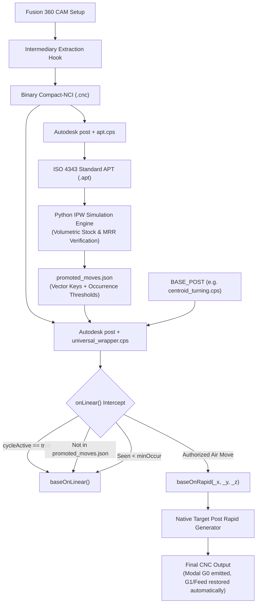

# Architecture Decision Record: Universal Post Processor Wrapper (`universal_wrapper.cps`)

## 1. Executive Summary & Problem Context

In Fusion 360 Personal Use licenses, Autodesk masks rapid positioning moves (`G0`), forcing them into linear cutting moves (`G1`) clamped to feedrates. Machinists running personal licenses on CNC lathes and mills suffer extreme cycle time penalties due to rapid retracts and clearance moves crawling at cutting feedrates.

Previous attempts to solve this via post-processing suffered from major architectural flaws:
1. **G-Code Regex / Line Slicing**: Brittle, dial-a-regex approaches modifying final G-code files break modal states (e.g., leaving a subsequent cutting move in `G0`, causing catastrophic tool crashes).
2. **Direct Compact-NCI Parsing**: The intermediate toolpath file generated by Fusion is a proprietary, closed binary CIMCO stream (`http://www.cimco-software.com/namespace/nc/format/compact-nci`) with zero public specifications or open-source parsers.
3. **Global Move Counter Drift**: Counting moves linearly diverges whenever a post processor expands canned cycles (`expandCyclePoint`), linearizes circular arcs, or splits moves for rotary unwind.

The **Universal CPS Wrapper** (`universal_wrapper.cps`) resolves these deficiencies by acting as a non-invasive, dynamic decorator around any target machine post processor (`BASE_POST`), intercepting moves verified by the 3D In-Process Workpiece (IPW) simulation engine and promoting them natively through the machine post's internal rapid handler (`baseOnRapid()`).

---

## 2. End-to-End Pipeline Architecture



---

## 3. Key Architectural Decisions (ADRs)

### AD-01: Decorator Pattern via Dynamic CPS Inclusion
* **Decision**: Implement the wrapper as a standalone CPS file that dynamically includes the target machine post using `include(basePostPath)`.
* **Rationale**: Machine posts (e.g., `centroid_turning.cps`, `tormach.cps`, `haas.cps`) remain 100% vendor-stock and unmodified. Any future vendor post updates can be dropped into the system without re-applying custom patches.
* **Mechanism**:
  ```javascript
  var basePostPath = getEnvironmentVariable("BASE_POST");
  include(basePostPath);
  ```

### AD-02: Bypassing CLI Property Escaping via Environment Variables
* **Decision**: Pass runtime parameters (`BASE_POST` path and `PROMOTED_MOVES_JSON` path) via OS environment variables rather than `--property` CLI arguments.
* **Rationale**: The Autodesk `post` CLI interprets slash characters (`/`) inside `--property` arguments as regular expression delimiters, throwing fatal errors such as `invalid regular expression flag b`. Environment variables bypass the CLI argument parser entirely and are directly accessible inside CPS JavaScript via `getEnvironmentVariable()`.

### AD-03: Coordinate Vector Keys vs. Global Move Counters
* **Decision**: Identify moves using a spatial coordinate vector key instead of global integer move counters:
  `secId:x1,y1,z1->x2,y2,z2`
  with coordinates normalized to fixed integer precision: `Math.round(val * 10000)` ($0.0001\text{ mm}$ or $0.00001\text{ in}$).
* **Rationale**: Integer move indexes drift whenever posts expand canned cycles, linearize arcs, or perform smoothing. Coordinate vector keys provide spatial idempotency and tie directly between intermediate APT toolpath moves and CPS callbacks.

### AD-04: Monotonic Stock Removal & Occurrence Gating (`minOccur`)
* **Decision**: Store occurrence thresholds as a single integer:
  ```json
  {
    "0:5270,0,100->2350,0,100": { "minOccur": 1 }
  }
  ```
* **Rationale**: In subtractive machining (milling and turning), material removal is strictly monotonic. Stock volume $V(t)$ never increases. Therefore, the cutting state of any fixed spatial vector is a step function:
  $$f(\text{occurrence}) \in \{0 \text{ (cutting)} \to 1 \text{ (air)}\}$$
  A path that cuts on Pass 1 and passes through air on Pass 2 (e.g., roughing retracts or spring passes) only requires an integer threshold $K = \text{minOccur}$. All occurrences $i \ge K$ are guaranteed air moves.

### AD-05: Selective Tracking / Zero Overhead for Cutting Moves
* **Decision**: Only allocate state and increment counters for vector keys present in `authorizedMap`.
* **Rationale**: In production toolpaths, ~95% of moves are cutting moves. The wrapper performs a single O(1) hash lookup `var entry = authorizedMap[key]`. If `!entry`, it immediately invokes `baseOnLinear()` without memory allocation or state mutation.

### AD-06: Native Delegation to `baseOnRapid()` for Modal Integrity
* **Decision**: Never inject raw `G0` strings. Instead, invoke the target post's native `baseOnRapid(_x, _y, _z)` function.
* **Rationale**: Calling `baseOnRapid` engages the machine post's internal modal tracking variables (e.g., `gMotionModal`). The post outputs the machine-specific rapid block (e.g., `G0 X...`) and marks the motion state as rapid. Consequently, the next cutting move invoking `baseOnLinear` automatically detects that motion mode changed, re-arming `G1` and outputting the feedrate (`F`). This guarantees zero risk of cutting under `G0`.

### AD-07: Canned & Drill Cycle Guard
* **Decision**: Hook `onCycle()` and `onCycleEnd()` to track `cycleActive`. Never promote moves while `cycleActive` is true.
* **Rationale**: Expanded canned cycles (deep hole pecking, tapping, boring) generate internal linear moves that must never be converted to rapid retracts inside holes.

### AD-08: Comment Character Filtering Resilience
* **Decision**: Do not rely on output comments for runtime control logic.
* **Rationale**: Machine posts (e.g., Centroid) sanitize comments using post-specific character filter tables (`permittedCommentChars`), stripping characters such as `:` and `>`. All promotion decisions are made in-memory in JavaScript before emitting any code.

---

## 4. Verification & Validation Proof

The implementation is verified via the automated test suite [`tests/test_universal_wrapper.py`](file:///Users/vadimf/Documents/Fusion360-Batch-Post-master/tests/test_universal_wrapper.py) running against genuine Autodesk CAM post binaries and captured intermediate toolpaths:

| Test Case | Description | Result |
| :--- | :--- | :--- |
| `test_01_passthrough_fidelity` | Baseline passthrough with no promotions produces identical G-code to direct post processing. | **PASS** |
| `test_02_single_rapid_promotion` | Authorized Move 11 (`0:5270,0,100->2350,0,100`) emits `N32 G0 X0.47` and subsequent block emits `N33 G1 Z-0.06 F0.002`. | **PASS** |
| `test_03_occurrence_gating` | Move configured with `minOccur: 2` is rejected on occurrence 1 and remains cutting `N32 X0.47`. | **PASS** |
| `test_04_multi_vector_promotion` | All 6 retract/clearance moves across multiple roughing passes are promoted with correct modal state transitions. | **PASS** |

---

## 5. File Inventory

- [`universal_wrapper.cps`](file:///Users/vadimf/Documents/Fusion360-Batch-Post-master/universal_wrapper.cps): The universal wrapper post processor.
- [`tests/test_universal_wrapper.py`](file:///Users/vadimf/Documents/Fusion360-Batch-Post-master/tests/test_universal_wrapper.py): Automated regression test suite.
- [`tests/fixtures/roughing_test.cnc`](file:///Users/vadimf/Documents/Fusion360-Batch-Post-master/tests/fixtures/roughing_test.cnc): Intermediate binary toolpath fixture for testing.
